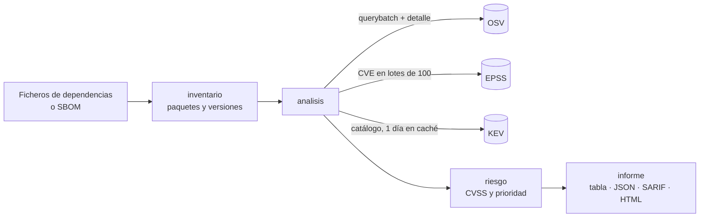

# triaje

Busca las vulnerabilidades conocidas de las dependencias de un proyecto y las **ordena por riesgo real**, no solo por su
gravedad. Para cada una pregunta tres cosas a tres fuentes públicas:

| Pregunta | Fuente |
|---|---|
| ¿Afecta a esta versión del paquete? | [OSV](https://osv.dev), que reúne GitHub Advisories, PyPA, la base de Go, RustSec y otras |
| ¿Es probable que alguien la explote en los próximos 30 días? | [EPSS](https://www.first.org/epss/), el modelo de FIRST |
| ¿Se está explotando ya? | El catálogo [KEV](https://www.cisa.gov/known-exploited-vulnerabilities-catalog) de CISA |

Y con eso dice **qué arreglar primero, por qué y a qué versión subir**.

```text
$ triaje -solo p2 ejemplo
12 paquetes en 3 ficheros · 204 vulnerabilidades
P1 urgente: 1 · P2 alta: 19 · P3 media: 60 · P4 baja: 124
(se muestran 20; las 184 de prioridad más baja quedan fuera)

Plan de actualización
PRIO  PAQUETE           FICHERO                DE      A        CIERRA
P1    golang.org/x/net  servicio/go.mod        0.7.0   0.23.0   2
P2    django            api/requirements.txt   3.2.0   4.2.26   11
P2    lodash            web/package-lock.json  4.17.4  4.17.21  2
...

Vulnerabilidades, de más a menos urgente
PRIO  PAQUETE           VERSIÓN  ARREGLO  VULNERABILIDAD  CVSS  EPSS     KEV  MOTIVO
P1    golang.org/x/net  0.7.0    0.17.0   CVE-2023-44487  5,3   >99,9 %  sí   se está explotando (catálogo KEV de CISA)
P2    golang.org/x/net  0.7.0    0.23.0   CVE-2023-45288  5,3   92,0 %   no   EPSS 92,0 %: probabilidad alta de que se explote en los próximos 30 días
P2    django            3.2.0    3.2.14   CVE-2022-34265  9,8   73,6 %   no   EPSS 73,6 %: probabilidad alta de que se explote en los próximos 30 días
P2    pyyaml            5.3.1    5.4      CVE-2020-14343  9,8   6,0 %    no   crítica (CVSS 9,8) y con probabilidad de explotación apreciable (EPSS 6,0 %)
...
```

<sub>Salida real sobre el [proyecto de ejemplo](ejemplo/), con dependencias viejas a propósito. Los datos de EPSS cambian cada día.</sub>

## Por qué no basta con el CVSS

Un escáner normal ordena por CVSS, y el CVSS mide **lo grave que sería** si alguien explotara la vulnerabilidad, no **lo probable
que es** que lo haga. En un proyecto con unas cuantas dependencias viejas salen decenas de «altas» y «críticas», y el equipo acaba
ignorándolas todas.

El ejemplo de arriba lo enseña bien: la vulnerabilidad más urgente, HTTP/2 Rapid Reset, tiene un CVSS de solo 5,3 («media»),
pero se usó en ataques reales de denegación de servicio y está en el catálogo KEV. Con el CVSS habría quedado por debajo de
decenas de «críticas» de Django que casi nadie intenta explotar.

## Cómo decide la prioridad

Las reglas se aplican en orden y la primera que se cumple manda:

| | Cuándo | Qué hacer |
|---|---|---|
| **P1 · urgente** | Está en el catálogo KEV: alguien la está explotando ya | Ahora |
| **P2 · alta** | EPSS ≥ 10 %, o crítica (CVSS ≥ 9) con EPSS ≥ 1 % o sin dato de EPSS | Esta semana |
| **P3 · media** | CVSS ≥ 7, EPSS ≥ 1 %, o no hay ningún dato de ella | En el próximo ciclo |
| **P4 · baja** | El resto: gravedad baja o media y explotación poco probable | Con las actualizaciones rutinarias |

- **Los umbrales de EPSS** siguen lo que recomienda FIRST: mirar la probabilidad, no solo el percentil. Un 10 % en 30 días ya está
  entre el 1-2 % de vulnerabilidades más peligrosas, y por debajo del 1 % la gran mayoría nunca llega a explotarse.
- **Cuando falta un dato, del lado prudente.** EPSS solo puntúa CVE, y hay vulnerabilidades que solo tienen identificador de GitHub
  o de Go. Una crítica sin EPSS va a P2, y una de la que no se sabe nada va a P3 para que alguien la mire, no a P4.
- **Cada hallazgo explica su prioridad** con una frase («crítica (CVSS 9,8) y con probabilidad de explotación apreciable (EPSS
  6,0 %)»), para que nadie tenga que fiarse de un número sin saber de dónde sale.
- **Dentro de cada prioridad** van primero las que están en KEV, luego por EPSS y por último por CVSS.

## Qué tiene de especial

- **Plan de actualización.** Además de la lista, agrupa por paquete y dice a qué versión subir para cerrar todas sus
  vulnerabilidades con arreglo publicado. Si la rama instalada ya no tiene soporte (Django 3.2), propone la primera versión de otra
  rama que sí lo arregla.
- **El CVSS se calcula, no se copia.** OSV da el vector CVSS 3 (`CVSS:3.1/AV:N/AC:L/...`), no la puntuación; triaje la calcula
  siguiendo la especificación de FIRST, incluido su redondeo (que evita que 4,000000001 se convierta en 4,1). Los tests comparan
  con la calculadora oficial. Si solo hay una etiqueta (`HIGH`), usa un valor representativo y lo marca con `≈`.
- **Sin duplicados.** OSV junta varias bases de datos y la misma vulnerabilidad puede llegar como `GHSA-...`, `PYSEC-...` y `GO-...`;
  se agrupan por sus alias y se queda la que tiene vector CVSS.
- **También la biblioteca estándar de Go**, que tiene sus propias vulnerabilidades y no aparece como dependencia. Se toma de la
  directiva `toolchain` o `go` del `go.mod` cuando dice la versión exacta.
- **Pensado para la CI.** `-fallar-en p2` termina con código 1 si hay algo de prioridad P2 o más urgente; el informe SARIF va
  directo a la pestaña de seguridad de GitHub con una huella estable para que las alertas no se cierren y reabran en cada análisis.
- **Aguanta que falle una fuente.** OSV es imprescindible, pero si EPSS o KEV no responden el análisis sigue (con un aviso) y
  prioriza con lo que tiene. El catálogo KEV se guarda un día en caché y, sin red, se usa la última copia.
- **Sin dependencias.** Solo la biblioteca estándar de Go: una herramienta que vigila la cadena de suministro no debería añadir
  eslabones a la suya.

## Uso

```bash
go install github.com/marnau74/triaje/cmd/triaje@latest
```

```bash
triaje                               # la carpeta actual, en tabla
triaje -solo p2 ruta/al/proyecto     # solo lo urgente
triaje -formato html -salida informe.html .
triaje -formato sarif -salida triaje.sarif -fallar-en p2 .
triaje sbom.cdx.json                 # un SBOM CycloneDX
```

| Opción | |
|---|---|
| `-formato` | `tabla` (por defecto), `json`, `sarif` o `html` |
| `-salida` | Fichero de destino; por defecto, la salida estándar |
| `-solo p2` | Enseña solo los hallazgos de esa prioridad o más urgentes |
| `-fallar-en p2` | Termina con código 1 si hay hallazgos de esa prioridad o más urgentes (aunque `-solo` los oculte) |
| `-sin-cache` | No usa ni guarda la copia local del catálogo KEV |
| `-tiempo-maximo` | Límite para consultar las fuentes (2 minutos por defecto) |

Códigos de salida: `0` bien, `1` se ha superado el umbral de `-fallar-en`, `2` error (de uso, al leer los ficheros o con OSV).

### Ficheros que lee

En una carpeta los busca de forma recursiva, sin entrar en `node_modules`, `vendor`, `.venv`, `target` y similares.

| Ecosistema | Fichero |
|---|---|
| Go | `go.mod` (con la biblioteca estándar) |
| npm | `package-lock.json` (formatos 1, 2 y 3) y `npm-shrinkwrap.json` |
| PyPI | `requirements*.txt`, solo las versiones fijadas con `==` |
| crates.io | `Cargo.lock` |
| NuGet | `packages.lock.json` |
| Cualquiera de los anteriores y Maven | SBOM CycloneDX en JSON (`*.cdx.json`, `bom.json`, `sbom.json`) |

Para Maven, Gradle u otros, genera antes un SBOM CycloneDX (con el plugin `cyclonedx-maven-plugin`, por ejemplo) y pásaselo.

### El informe HTML

Una sola página sin nada externo, para adjuntarla a un ticket o guardarla como artefacto de la CI: el plan de actualización, las
cifras por prioridad (que sirven de filtro), un buscador y el detalle de cada vulnerabilidad con su motivo, el vector CVSS, los
datos de EPSS y KEV y el enlace a OSV. Tiene modo claro y oscuro y se ve bien en el móvil.

### En GitHub Actions

```yaml
permissions:
  contents: read
  security-events: write
steps:
  - uses: actions/checkout@v7
  - uses: actions/setup-go@v7
    with:
      go-version: stable
  - run: go run github.com/marnau74/triaje/cmd/triaje@latest -formato sarif -salida triaje.sarif -fallar-en p2 .
  - uses: github/codeql-action/upload-sarif@v4
    if: always() # para ver las alertas aunque el paso anterior falle
    with:
      sarif_file: triaje.sarif
      category: triaje
```

Conviene ejecutarlo también de forma programada (una vez por semana, por ejemplo): las vulnerabilidades aparecen aunque nadie
toque el código. La [CI de este repositorio](.github/workflows/ci.yml) hace las dos cosas y además prueba el proyecto de ejemplo
contra las fuentes reales.

## Cómo está hecho



```text
cmd/triaje/          la CLI: opciones, códigos de salida
internal/inventario/ un lector por formato de fichero
internal/fuentes/    clientes de OSV, EPSS y KEV, con reintentos y caché
internal/riesgo/     cálculo del CVSS 3 y reglas de prioridad
internal/analisis/   junta todo: duplicados, versión de arreglo, orden y plan
internal/informe/    las cuatro salidas
internal/falso/      servidor que imita las tres fuentes para los tests
ejemplo/             proyecto con dependencias vulnerables a propósito
```

- **Pocas peticiones.** Todos los paquetes van a OSV en una sola consulta por lotes (hasta 1000), siguiendo la paginación de los que
  tienen muchas vulnerabilidades; el detalle de cada una se pide una vez, con 8 peticiones en paralelo como máximo. Las CVE van a
  EPSS de 100 en 100.
- **Reintentos con espera** ante un 429 o un 5xx, y un tiempo máximo para todo el análisis.
- **La versión de arreglo** se busca en los rangos de OSV: la menor versión corregida posterior a la instalada. Comparar versiones de
  ecosistemas distintos (semver, PEP 440, NuGet) se hace con una comparación tolerante por trozos que sabe que `1.2.0-rc1` y
  `1.2.0b1` van antes que `1.2.0`.

## Tests

```bash
go test ./...
```

Cubren cada lector de ficheros, el cálculo del CVSS contra la calculadora oficial, cada regla de prioridad, la comparación de
versiones, la paginación de OSV, los duplicados, la caché de KEV (y su uso sin red), el análisis con EPSS caído, las cuatro
salidas (incluido que el HTML escapa lo que viene de fuera) y los códigos de salida de la CLI. Todo contra un servidor falso, sin
red. Los que protegen algo importante se han comprobado rompiendo el código a propósito para ver que fallan.

## Límites conocidos

- **Solo versiones exactas.** `requirements.txt` con rangos (`>=`) no dice qué versión se instala; para Python es mejor pasarle la
  salida de `pip freeze` o un SBOM.
- **No resuelve dependencias**: lee lo que dicen los ficheros de bloqueo. Sin `package-lock.json` no hay transitivas de npm.
- **CVSS 4 no se calcula** todavía: si una vulnerabilidad solo trae vector 4, se usa la etiqueta de gravedad de la base de datos.
- **Alcanzabilidad.** No sabe si tu código llega a usar la función vulnerable. Para Go, `govulncheck` sí lo hace y es un buen
  complemento.
- **EPSS es una predicción**, no una garantía, y KEV recoge lo que CISA ha confirmado, no todo lo que se explota.

## Licencia

[MIT](LICENSE).
